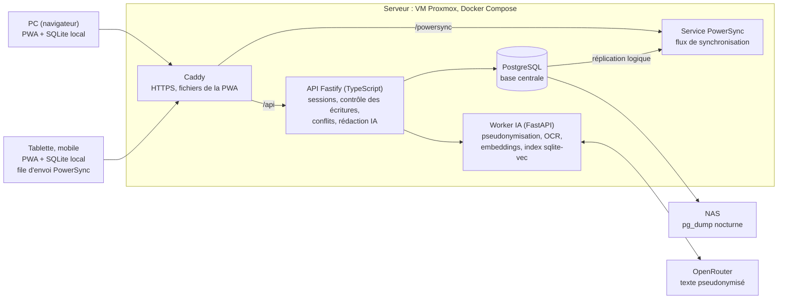
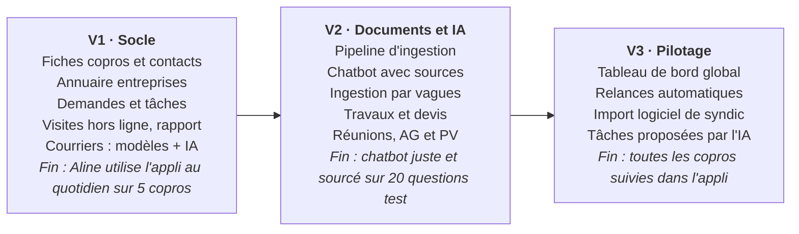

# Immobilier Aline — Spécifications

Version du 2 novembre 2026 · Julien

> Document de référence. Toute modification des spécifications se fait ici, dans le repo.

## Contexte et objectifs

L'application centralise la gestion d'environ 100 copropriétés pour une gestionnaire de syndic, avec une IA qui rédige, lit les documents scannés et répond aux questions.

Elle tourne en local sur PC ou sur un serveur auto-hébergé, et reste utilisable hors ligne sur le terrain.

Objectifs :

- Retrouver en quelques secondes une information sur une copro (vote d'AG, contrat, prestataire, sinistre).
- Réduire le temps de rédaction des courriers, rapports de visite et PV.
- Suivre les demandes et les travaux de bout en bout, sans rien oublier.
- Garder la maîtrise des données (hébergement local, RGPD).

Utilisatrice cible : une gestionnaire (Aline), sur PC au bureau et sur tablette ou téléphone en visite.

## Périmètre fonctionnel : modules

Huit modules couvrent le quotidien du syndic ; l'IA (section suivante) s'appuie sur chacun.

| Module | Contenu | Hors ligne | Version |
| --- | --- | --- | --- |
| Copropriétés | Fiche immeuble, alias, lots, copropriétaires, conseil syndical, contrats, documents | Lecture + saisie | V1 |
| Demandes | Tickets (fuite, nuisance, sinistre…), statut, priorité, historique, relances | Lecture + saisie | V1 |
| Entreprises et devis | Annuaire par corps de métier, demande de devis multi-entreprises, comparatif | Lecture | V1 (annuaire), V2 (devis) |
| Courriers | Modèles Word, brouillon IA, validation, historique d'envoi | Saisie, génération IA différée | V1 |
| Visites | Checklist, photos, notes vocales, rapport PDF | Complet (cas clé) | V1 |
| Travaux | Besoin, devis, vote AG, ordre de service, suivi, réception | Lecture + saisie | V2 |
| Réunions et AG | Ordre du jour, présences, résolutions, votes, PV | Lecture + saisie | V2 |
| Tableau de bord | Échéances, relances, demandes ouvertes, toutes copros | Lecture | V3 |
| Administration | Comptes et rôles, sessions des appareils, état des services, modèles IA, journal des actions | Non (en ligne uniquement) | V1 |

Règle commune : chaque objet est rattaché à une copro, ce qui permet le filtrage partout et le ciblage du chatbot.

## Fonctions IA

Trois fonctions IA, toutes servies par des modèles cloud via OpenRouter, avec un modèle choisi par tâche.

### 1. Rédaction automatique

1. Aline choisit un type de document et le rattache à une copro, une demande, une visite ou une réunion.
2. Le système assemble le contexte : fiche copro, historique, notes, photos, documents liés.
3. Le LLM rédige le brouillon, injecté dans le modèle Word correspondant.
4. Aline relit, corrige, valide. Rien ne part sans validation.
5. Les courriers validés servent d'exemples pour caler le style (few-shot).

Types prévus : relance, mise en demeure, convocation, demande de devis, réponse à copropriétaire, rapport de visite, compte rendu de conseil syndical, PV d'AG.

Rapport de visite : notes vocales transcrites (Whisper local) puis structurées par l'IA en constats, photos légendées et actions.

### 2. Analyse des documents scannés

Chaque document importé passe par le pipeline d'ingestion (voir plus bas) : OCR, classification, extraction, indexation.

- Types reconnus : règlement de copropriété, PV d'AG, contrat, devis, facture, sinistre, courrier, plan, diagnostic.
- Données extraites vers la base : dates, montants, entreprises, résolutions et votes, échéances de contrat.
- Actions automatiques proposées : tâche « contrat qui expire dans 3 mois », rattachement d'un devis à une demande.
- Toute extraction reste modifiable et marquée « à vérifier » tant qu'Aline ne l'a pas confirmée.

### 3. Chatbot copro

- Détection de la copro visée (nom, adresse, alias) puis filtrage automatique ; possibilité d'interroger toutes les copros.
- RAG hybride : recherche vectorielle + mots-clés dans les documents, plus requêtes directes sur la base structurée (outils SQL en lecture seule).
- Chaque réponse cite ses sources : document, page, lien cliquable vers l'extrait.
- Réponse « je ne trouve pas » plutôt qu'une invention.

### Modèles par tâche (OpenRouter)

| Tâche | Gamme de modèle | Critère |
| --- | --- | --- |
| Rédaction courriers, rapports, PV | Haut de gamme (Claude Sonnet ou équivalent) | Qualité du français, ton |
| Chatbot RAG | Haut de gamme | Précision, citations |
| Classification, extraction | Rapide et peu cher | Volume |
| Scans illisibles | Modèle vision | Secours de l'OCR local |

Les modèles sont paramétrables dans l'admin, sans changer le code.

## Architecture technique et stack

Chaque appareil travaille sur sa propre base SQLite, synchronisée par PowerSync avec PostgreSQL sur le serveur ; une API TypeScript valide toutes les écritures, et un worker Python, interne, porte l'IA.

Lecture : les écritures montent par l'API, les données redescendent par PowerSync. Le worker IA n'est joignable que par l'API, et seul lui appelle OpenRouter.

| Couche | Choix | Raison |
| --- | --- | --- |
| Interface | React + Vite, PWA (vite-plugin-pwa, Workbox) | Rouvre hors connexion après une première visite |
| Données sur l'appareil | PowerSync Web + SQLite (wa-sqlite) | Lecture et écriture locales ; file d'envoi jusqu'au retour du réseau |
| API | Fastify + TypeScript | Reçoit les écritures, vérifie les droits, applique les règles et le contrôle de version |
| Base centrale | PostgreSQL 17 (réplication logique) | Données partagées ; PowerSync répercute les changements vers les appareils |
| Synchronisation | Service PowerSync auto-hébergé (Sync Streams) | Diffusion incrémentale vers chaque appareil |
| Sessions | JWT RS256 (1 h) + jeton de renouvellement (60 j, usage unique) | Même jeton pour l'API et PowerSync (clé publique en JWKS) |
| Schéma partagé | `shared/src/tables.ts` | Une seule définition pour l'API et le schéma local des appareils |
| Recherche | sqlite-vec + FTS5 | Index propre au worker IA, reconstructible depuis les documents |
| Worker IA | Python, FastAPI | Écosystème OCR et IA |
| OCR | Tesseract ou PaddleOCR | Local, gratuit |
| Embeddings | bge-m3 | Local, bon en français |
| Transcription | Whisper small ou medium | Local, sur CPU |
| LLM | OpenRouter | Un modèle par tâche, interchangeable |
| Documents | docxtemplater + PDF | Modèles Word d'Aline |
| Hébergement | Docker Compose + Caddy (HTTPS) | Le service worker exige un contexte sécurisé (sauf `localhost`) |

## Modèle de données

La copropriété est la racine : toute donnée y est rattachée, directement ou via une demande, un chantier ou une réunion.

| Collection | Champs principaux | Liée à |
| --- | --- | --- |
| copropriete | nom, alias[], adresse, nb lots, syndic depuis, notes | — |
| lot | numéro, type, tantièmes, étage | copropriete |
| personne | nom, rôle (copropriétaire, locataire, CS, gardien), coordonnées | copropriete, lot |
| entreprise | raison sociale, corps de métier, contacts, SIRET, assurance | — |
| contrat | objet, date début / fin, préavis, montant | copropriete, entreprise |
| demande | titre, catégorie, statut, priorité, demandeur, échéance | copropriete, personne |
| chantier | objet, statut, budget voté, dates | copropriete, demande, resolution |
| devis | montant HT / TTC, date, validité, statut | chantier ou demande, entreprise |
| courrier | type, destinataire, corps, statut (brouillon, validé, envoyé) | copropriete + objet source |
| visite | date, checklist, notes, transcription, rapport | copropriete |
| photo | fichier, légende, horodatage | visite ou demande |
| reunion | type (CS, AG), date, présents, ordre du jour, PV | copropriete |
| resolution | intitulé, majorité, résultat, votes | reunion |
| document | fichier, type, date, statut d'ingestion, texte OCR | copropriete + objet lié |
| extraction | champ, valeur, confiance, vérifié | document |
| tache | titre, échéance, statut, origine (manuelle, IA) | tout objet |
| journal | action, objet, horodatage, auteur | tout objet |

Chaque fiche porte un identifiant UUID généré par l'appareil : une fiche créée hors ligne garde son identifiant, et un renvoi après coupure ne crée pas de doublon. Elle porte aussi une `version`, incrémentée par l'API à chaque modification, qui sert à détecter les modifications concurrentes.

La table `conflit` consigne les écritures que le serveur n'a pas appliquées ; elle est synchronisée vers les appareils pour que l'utilisatrice tranche. Les comptes (`utilisateur`, jetons de renouvellement) ne sont jamais synchronisés.

Les passages découpés des documents et leurs embeddings ne sont pas dans PostgreSQL : ils vivent dans l'index SQLite du worker IA (sqlite-vec + FTS5), reconstructible à partir des documents.

## Pipeline d'ingestion documentaire

Chaque document passe par six étapes asynchrones, exécutées par le worker IA ; l'OCR et les embeddings tournent en local, seules la classification et l'extraction appellent OpenRouter.

1. **Import** : glisser-déposer, dossier surveillé ou scan direct ; la copro est choisie ou devinée à partir du contenu.
2. **OCR** : extraction du texte natif si le PDF en contient, sinon Tesseract ou PaddleOCR en local ; modèle vision en secours sur les pages illisibles.
3. **Classification** : le type de document est déduit des premières pages par un modèle peu cher.
4. **Extraction** : champs propres au type (dates, montants, résolutions, échéances), stockés avec un score de confiance et le statut « à vérifier ».
5. **Découpage et indexation** : passages de 500 à 800 tokens avec chevauchement, numéro de page conservé, embeddings bge-m3 en local, stockage dans l'index du worker (sqlite-vec + plein texte FTS5).
6. **Actions** : tâches proposées (échéance de contrat, relance), rattachement à une demande ou un chantier.

Volume estimé pour 100 copros : 50 000 à 150 000 pages, 50 à 200 Go de scans. Ingestion par vagues : d'abord règlements de copropriété et 3 derniers PV d'AG par copro, puis l'historique en tâche de nuit.

Coût : la classification ne lit que les premières pages, et l'extraction utilise un modèle bon marché ; le coût d'ingestion initiale reste à chiffrer sur un échantillon réel.

## Mode hors ligne et synchronisation

L'application reste utilisable sans réseau pour la consultation et la saisie ; tout ce qui demande l'IA est mis en file d'attente et traité au retour de la connexion.

| Fonction | En ligne | Hors ligne |
| --- | --- | --- |
| Consulter copros, contacts, demandes | Oui | Oui (copie locale) |
| Créer ou modifier une demande, une visite | Oui | Oui, synchronisé ensuite |
| Photos et notes vocales | Oui | Oui, envoyées ensuite |
| Consulter un document scanné | Oui | Seulement s'il a été mis en cache |
| Rédaction IA, chatbot | Oui | Non : demande mise en file |
| Import et analyse de documents | Oui | Non |

Principe technique :

- Chaque appareil garde une base SQLite locale (PowerSync), avec par défaut les données de toutes les copros, sans les fichiers.
- Chaque écriture est appliquée localement tout de suite, puis placée dans la file d'envoi de PowerSync. Au retour du réseau, le connecteur envoie la file par lots à l'API (`POST /api/sync/upload`). La reprise se déclenche à la réouverture de l'application et au retour du réseau tant qu'elle est ouverte ; une synchronisation application fermée dépend des capacités du navigateur.
- L'interface distingue « Sur cet appareil » (écriture pas encore reçue par le serveur) de « Synchronisé ».
- Avant une visite, Aline peut « préparer la copro » : les documents clés de cette copro sont mis en cache sur l'appareil.

**Modifications concurrentes (plusieurs appareils)**

1. Chaque modification transmet la version de la fiche sur laquelle l'appareil a travaillé.
2. Si la fiche a changé entre-temps sur le serveur, l'API n'écrase pas : elle consigne un conflit (valeurs de l'appareil et valeurs actuelles), et l'appareil reçoit la version du serveur.
3. Une écriture invalide (fiche parente supprimée, valeur refusée) est consignée de la même façon, en « rejet », sans bloquer les écritures suivantes.
4. Dans l'écran « Conflits », l'utilisatrice choisit : appliquer sa modification (renvoyée sur la version actuelle) ou garder la version actuelle.

## Sécurité, RGPD, sauvegardes

Les données des copropriétaires restent sur le serveur ; seuls des textes pseudonymisés partent vers OpenRouter.

**Envoi vers l'IA cloud**

- Pseudonymisation avant chaque appel : noms, adresses, téléphones, e-mails, IBAN remplacés par des jetons (`[PERSONNE_12]`), ré-injectés au retour.
- OpenRouter configuré pour ne router que vers des fournisseurs sans rétention ni entraînement sur les données.
- Journal de chaque appel IA : date, tâche, modèle, volume de tokens, sans le contenu.

**Accès**

- Comptes gérés dans l'écran Administration (mots de passe hachés scrypt, 12 caractères minimum) ; accès distant uniquement via HTTPS ou VPN.
- Deux rôles : administrateur (gestion des comptes et des réglages) et gestionnaire. Le dernier administrateur actif ne peut pas être rétrogradé ni désactivé.
- Premier lancement : tant qu'aucun compte n'existe, un code à usage unique écrit dans les journaux du serveur permet de créer l'administrateur depuis l'écran.
- Chaque requête relit le compte en base : un compte désactivé perd l'accès immédiatement, ses sessions sont supprimées et ses appareils effacent leurs données locales à la reconnexion.
- Toute action d'administration est tracée (auteur, date, avant / après).
- Jeton d'accès RS256 d'une heure, renouvelé avec un jeton à usage unique de 60 jours ; la désactivation d'un compte révoque ses renouvellements.
- Clé API OpenRouter stockée côté serveur, jamais dans le front.
- Le worker IA n'est pas exposé : seule l'API l'appelle, après avoir vérifié la session et assemblé le contexte.
- Toute écriture passe par l'API : liste blanche des tables et colonnes, types vérifiés, colonnes gérées par le serveur (version, dates) ignorées.
- La déconnexion efface la base locale de l'appareil.

**RGPD**

- Registre de traitement à tenir par le cabinet ; l'application fournit l'export et la suppression des données d'une personne.
- Durées de conservation paramétrables par type de document.

**Sauvegardes**

- Dump PostgreSQL (et clés de signature des sessions) chaque nuit vers le NAS, avec rétention 30 jours.
- Copie hors site chiffrée (règle 3-2-1).
- Test de restauration trimestriel.

## Infrastructure et déploiement

Cible recommandée : une VM sur le Proxmox, avec cinq conteneurs Docker et des sauvegardes vers le NAS ; aucun GPU nécessaire puisque le LLM est dans le cloud.

| Ressource | Minimum | Recommandé |
| --- | --- | --- |
| vCPU | 4 | 8 |
| RAM | 16 Go | 32 Go |
| Stockage | SSD 500 Go | SSD 1 To |
| GPU | Aucun | Aucun |

Conteneurs (docker-compose) :

- `postgres` : PostgreSQL 17 avec réplication logique ; rôle `powersync` dédié en lecture et réplication.
- `api` : Fastify ; applique les migrations SQL au démarrage.
- `powersync` : service de synchronisation, stockage interne dans une base séparée du même Postgres.
- `ai-worker` : FastAPI ; OCR, embeddings, Whisper, appels OpenRouter. Réseau interne uniquement.
- `web` : Caddy, qui sert la PWA, relaie `/api` et `/powersync`, et gère le HTTPS automatique.

Mode PC : le même ensemble lancé via Docker Desktop sur le poste d'Aline. Le mode serveur reste recommandé pour 100 copros (volume de documents, sauvegardes, accès depuis la tablette).

Mises à jour : images versionnées, migration de schéma automatique au démarrage, sauvegarde forcée avant chaque mise à jour.

## Roadmap

Trois phases, chacune close par un critère d'usage réel plutôt qu'une date ; les durées seront fixées une fois les points ouverts levés.

La V1 se teste sur 5 copros pilotes avant d'élargir ; l'ingestion massive des archives n'arrive qu'en V2, quand le pipeline est validé sur un échantillon.

## Points ouverts

- [ ] Volume réel de documents existants à numériser, et format actuel (papier, PDF, logiciel)
- [ ] Logiciel de syndic utilisé aujourd'hui : export ou import possible ?
- [ ] Modèles Word existants pour courriers, convocations et PV
- [ ] Aline seule utilisatrice, ou d'autres collaborateurs à prévoir ?
- [ ] Appareil de terrain : tablette Android, iPad ou téléphone ?
- [ ] Envoi des courriers : export PDF à envoyer à la main, ou envoi e-mail depuis l'application ?
- [ ] Budget mensuel acceptable pour les appels OpenRouter
- [ ] Accès distant : VPN ou exposition HTTPS publique ?
- [ ] Combien d'appareils et de personnes : Aline seule sur PC + tablette, ou d'autres gestionnaires (droits par copropriété) ?
